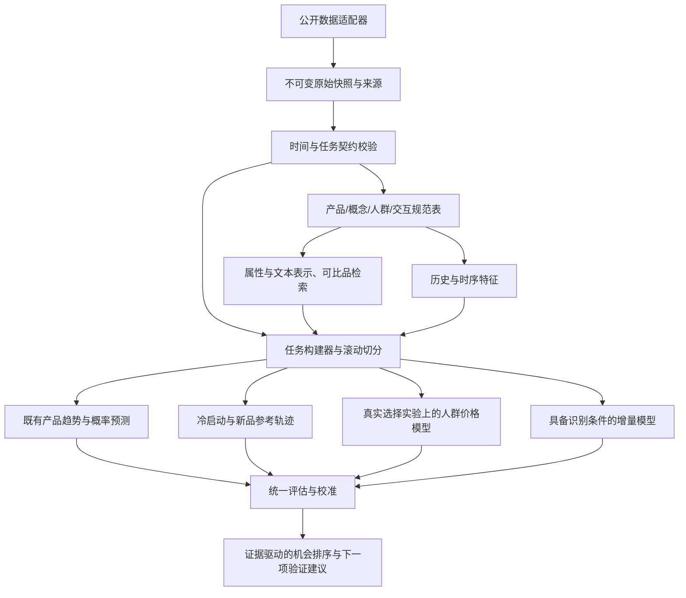

# Brand Audience Intelligence 架构评审与改进路线

评审日期：2026-11-05。范围仅限品牌项目。审阅 `src/brand_intel/cli.py`、配置、测试、数据契约说明和现有实测结果；执行现有 9 个测试及两项隔离诊断。未修改生产训练逻辑、标签或现有模型结果。论文用于设计参考，不构成我们数据上的精度保证。

## 结论

当前是一个有时间边界意识的评论活动基线原型，不是完整的品牌人群与新品机会平台。下一步优先级为：任务/产物契约 → 有效的稀疏与滚动评估 → 概念与人群表示 → 概率预测 → 真实选择实验 → 增量决策。无需马上引入微服务、向量数据库、RL 或大规模生成式模型。

## 当前数据流

公开 Amazon gzip → SQLite 评论事件 → 历史快照 / 固定周频序列 / 关键词评论者描述 → 单个 LightGBM 分类器与回归器 / 朴素时序 / 可选 Chronos。

PyMC 的选择模型是独立的实验输入接口，目前没有与产品、人群和时序模块形成可验证的数据闭环。生产函数、数据转换、模型适配和指标都在同一 444 行 CLI 模块。

### 已有值得保留的设计

- 使用公开数据，原始文件与产物从 Git 排除。
- 历史特征严格使用 cutoff 之前的评论，标签窗口半开。
- 训练标签窗口不跨入验证预测时点。
- 阈值仅从训练标签计算，保留 persistence 对照。
- 识别静态元数据的时间问题，未把快照价格与累计评价当成历史特征。
- 未把未观察商品伪造为负反馈，也未把评论伪造成价格选择实验。

## 发现与证据

### R1 [优先修复] 同类别不能保证同一任务与数据版本

位置：`cli.py:115`、`cli.py:316`、`cli.py:342`。

`require_category` 只检查类别。对同一个已生成的 4 周输入，将配置 `forecast_weeks` 改为 8 后，`forecast(..., False)` 仍成功返回，报告写为 8 周，实际每个产品仍只有 4 个测试周。诊断完全在临时目录运行。

影响：修改预测期、切分、阈值或特征后，可能把旧输入和新配置拼成看似有效的实验。现有 SHA 记录尚未贯穿所有下游产物。

方案：新增不可变 TaskSpec/ArtifactManifest；绑定任务类型、目标、单位、时间频率、预测期、cutoff、资格规则、标签规则、特征版本、原始数据与 CSV 内容哈希。模型运行同时记录代码版本、数据版本、依赖锁与模型权重 revision。加载时不匹配即拒绝；预测输出按实际日期轴校验，不单从当前配置写报告。使用 run_id 和临时目录成功后原子发布，避免失败的半成品目录阻止重跑。

验收：用 8 周配置加载 4 周数据必须失败；改动 CSV 内容、raw hash、特征定义或 cutoff 也必须被发现；失败运行不得发布 completed 状态。

### R2 [优先修复] 时序评估遗漏最重要的稀疏对照

位置：`cli.py:243`、`cli.py:343`。

当前 400 个产品周测试观测中 90.5% 为零。重新计算得到：始终预测零 MAE=0.125；最近四周均值=0.18875；上期值=0.225。后两者都没有超过零预测。这个结果说明单独追求总体 MAE 可能主要奖励不预测增长，并不证明零预测能识别爆品。

方案：预先纳入零预测、均值、近期水平，以及适用的间歇需求方法；加入多起点滚动回测。分别报告有事件/无事件、历史稀疏度、活跃度和新品阶段的指标；同时报告预测分布的 proper scoring rules、校准与预算相关排名。Top-100 是当前明确的高活跃资格集合，不代表全类别性能，必须与全资格集合和新出现产品的任务分开。

验收：任何模型的报告都包含零基线；在多个时间窗口和分层中与强基线比较；没有实际执行的模型不能被列为通过。

### R3 [核心能力缺口] 当前预测路径排除了真正的零历史新品

位置：`cli.py:189-190`、`cli.py:25`。

输入必须有既往评论，主要特征也是历史评论量。因而从结构上无法对没有历史的概念评分；现有测试还明确排除 cutoff 之后才出现的产品。这个行为在“既有产品评论趋势”任务下合理，在新品任务下不能复用为效果证明。

方案：将 TrendTask、ColdStartTask、ConceptChoiceTask 明确分开。为新概念构造属性与需求表示，检索在当时已知的可比产品，结合参考轨迹和层级先验；有早期反馈后再更新。每个模块先检查证据是否充足，无法支持时返回 insufficient_evidence。首次观察到的评论不作为真实上市日期；仅能建立明确标注的 first-observed cohort 代理任务。

验收：未见过的产品 ID 可仅凭支持的属性进入冷启动适配器；相似品筛选不使用未来销量/评论；静态快照和预训练语料未知时间边界的实验不得冒称严格历史零样本预测。

### R4 [核心能力缺口] 评论者描述尚未成为人群—概念模型

位置：`cli.py:19`、`cli.py:255`、`cli.py:391`。

固定词表偏向美妆，与 Subscription Boxes 不完全匹配；关键词出现不能分辨“喜欢香味”和“讨厌香味”。当前描述中的 scent/texture/packaging/value 评论者数量分别为 3/0/1/25，且群组重叠。SQLite 丢弃了原评论正文，catalog 导出也没有保留丰富的产品描述用于表示学习。原始公开文件仍保留，因此可以通过重新处理恢复。

选择适配器只用了一个属性分值和价格。虽然保留 respondent_id，但未进入效用方程，也没有随机偏好系数或 panel 分组建模，不能据此声称实现了个体人群差异。价格变异、共线性、收敛与样本外拟合也未验证。

方案：先保留可追溯的文本/属性表和证据 event_id，做可人工核对的方面—情绪抽取与 TF-IDF/主题表示基线，再比较领域 embedding。选择数据齐备后采用共享属性效用与分层 Mixed Logit、重复选择 group_id；保留不购买选项，并按消费者留出验证。不能从评论者推导总体市场规模或人口统计。

验收：方面提及、情绪和偏好分开；有标注集衡量抽取质量；同一价格/属性组合在不同有证据的人群下可产生不同预测；没有真实实验数据时该能力保持未验证。

### R5 [模型与目标不一致风险] 分类、数量与时序没有共同概率契约

位置：`cli.py:280`、`cli.py:288-304`、`cli.py:333-352`。

独立分类器估计高活动概率，另一个 log1p-MAE 回归器预测点值；二者没有保证由同一分布推导。回归器在 log 尺度选择模型，报告在原尺度评分；不能把逆变换点值自动解释成条件期望。Chronos 任务是 4 周，分类回归是 90 天，目前不是同一任务的公平对照。

方案：统一模型适配器接口，明确输出 mean/median/quantiles/hit_probability 的语义。比较 Poisson、过度离散的 Negative Binomial、必要时 hurdle 模型及分位数回归，分离“是否出现活动”与“正活动规模”。分类概率可从经过验证的计数分布推导，也可以保留独立分类器，但需测一致性与校准。DeepAR/TFT/Chronos 仅在相同目标、资格、cutoff、预测期和指标下比较，先将 28 天共同基准打通，再独立扩展 90 天。

验收：概率范围、非负支持、分位数顺序与覆盖率正确；阈值概率和计数分布的推导关系可测试；比较报告明确是否同目标同预测期。

### R6 [研究证据不足] 只有一次测试期、两个阳性

当前训练/验证/测试高活动率约为 10.74%/3.23%/0.78%。测试集 257 个产品仅 2 个阳性；AP 的变化会被个别排序主导。当前 AP：AutoGluon=0.3088、persistence=0.4167。不得把已有 MAE 改善推导为爆品识别能力改善。

方案：保留当前已查看测试期为探索记录，重新建立 development 滚动窗口与未查看的最终测试。按时间与产品族/品牌分别评估泛化；重叠窗口不得按独立行估计不确定性。目标同时区分绝对高活动、相对自身增长与品类调整后的增长，并在研究开始前冻结定义。不能为了增加阳性而事后调门槛。

验收：报告每折样本数、事件数、候选集合和不确定性；小事件样本标记 insufficient_evidence；不使用任意统一阳性数量宣称统计可靠。

### R7 [工程维护] 单模块、隐式产物状态与版本不完整

位置：`cli.py`、`pyproject.toml`。

444 行模块耦合了下载、SQLite、特征、模型、选择和报告；固定路径跨运行覆盖，多进程共用临时 DB 名称；失败训练创建目录后重跑直接被阻止。PyMC 与 Chronos 的拟合/预测路径没有成功的真实集成测试，现有 9 项测试主要覆盖输入和时间不变量。

方案：保持单仓库、单机批处理，按职责拆包；统一任务协议、运行状态和后端接口，保留各后端独立环境。持久化模型 revision、执行状态与错误原因；离线缓存权重，避免每次评估将下载失败与模型失败混为一谈。小型有明确合成标记的后端测试可用于验证接口，不作为市场效果证据。

验收：数据层无模型依赖、CLI 无训练实现；模型 smoke test 和真实评估状态分开；失败可恢复；报告可按 run_id 重现。

## 论文与实践对照

以下是与本任务直接相关、证据或方法有代表性的参考，不是所有数据集上的统一最强排名。

| 来源 | 可迁移的设计 | 本项目采用方式 | 边界 |
| --- | --- | --- | --- |
| Amazon TrendSpotter，CIKM 2023 | 先定义趋势标签，再用行为序列预测并做线上验证 | 分开绝对热度与趋势，显式比较统计趋势基线 | 点击/购买信号在本数据中不存在，不能复制其业务增益 |
| DeepAR | 跨相关序列学习概率预测 | 与简单计数/分位数基线比较全局概率模型 | 稀疏小数据上不保证胜出 |
| TFT，IJF 2021 | 静态、历史观测与未来已知输入分型，多预测期 | 先采用输入契约，不急于使用 Transformer | attention 不是因果解释 |
| Chronos-2，2025 | 多变量、协变量与相关序列信息共享 | 保留对照，记录模型权重和输入分组 | zero-shot 不等于无证据预测全新概念 |
| BLaIR，2024 起、2026 修订 | 产品文本与自然语言语境表示 | 与简单文本表示比较概念/需求检索 | 模型使用 Amazon Reviews'23，需警惕同源历史评估污染 |
| Amazon BFS，SIGIR 2026 | 用替代品行为给新产品 warm start | 时间一致的可比品检索与参考轨迹 | 原工作验证搜索排序，不是销量或支付意愿预测 |
| Train 离散选择 / Mixed Logit | 属性效用、偏好异质性与 panel 选择 | 真实选择实验上的分层概念—人群—价格模型 | 评论、模拟人群不等于真实选择；观察价格不自动有因果含义 |
| EconML DML / causal forests | 混杂控制、交叉拟合与异质性干预效果 | 数据具备实验/识别条件后独立启用 | 预测和营销增量不是同一个目标 |
| Google Rules of ML | 可靠端到端管线、简单基线、训练服务一致 | 实验产物身份与失败状态优先 | 不意味着必须引入大规模云平台 |

可跟踪的新研究：[CDLF，2026](https://arxiv.org/abs/2604.20370) 将静态属性、类似品轨迹和早期观测结合做生命周期预测。它支持上述信息结构的研究价值，但属于新增候选路线，尚未在本项目验证，不作为立即采用 diffusion 的依据。

## 建议的目标架构



建议目录：

```text
src/brand_intel/
  cli.py
  contracts/     # TaskSpec, capabilities, artifact identity
  data/          # source adapters, normalized stores, provenance
  features/      # point-in-time features, text representations
  tasks/         # trend, cold_start, audience, choice, causal
  models/        # naive, AutoGluon, count, Chronos, PyMC adapters
  evaluation/    # rolling splits, calibration, ranking, uncertainty
  experiments/   # lifecycle, run registry, backend execution
  reporting/     # comparable evidence, limitations, decision outputs
```

无需跨仓库依赖个人推荐项目。SQLite 可保留；文本与特征可逐步增加 Parquet/DuckDB，根据规模再决定基础设施升级。

## 分阶段实施顺序与验收

| 阶段 | 交付 | 验收重点 |
| --- | --- | --- |
| P0 可信实验 | 修复任务版本匹配，增加零基线、滚动评估、来源绑定、运行状态 | 4/8 周混用被拒绝；强基线和实际执行状态完整 |
| P1 任务与表示 | 拆职责模块，保留文本，配置品类方面，建立冷启动接口与证据门槛 | 历史趋势和概念任务分开；未知 ID 支持特征输入；不伪造时间可用性 |
| P1 概率与对照 | 简单计数/分位数模型，统一 28 天比较与校准 | 同数据同目标同预算比较；超越基线的证据来自多个开发期 |
| P2 人群与价格 | 公开真实选择数据或前瞻实验，分层偏好、panel 测试与收敛诊断 | 消费者留出，属性价格可识别，输出选择概率的适用范围明确 |
| P2 新品机会 | 参考轨迹、层级先验、早期更新和 OOD 不确定性 | 代理冷启动和真实上市验证分别报告 |
| P3 增量与决策 | 有条件的数据上增量模型、成本收益和主动验证建议 | 不将评论增长解释为销售增量；最终用前瞻实验检验 |

## 来源

- [TrendSpotter](https://www.amazon.science/publications/trendspotter-forecasting-e-commerce-product-trends)
- [DeepAR](https://arxiv.org/abs/1704.04110)
- [TFT](https://research.google/pubs/temporal-fusion-transformers-for-interpretable-multi-horizon-time-series-forecasting/)
- [Chronos-2](https://arxiv.org/abs/2510.15821)
- [BLaIR](https://arxiv.org/abs/2403.03952)
- [Amazon BFS](https://www.amazon.science/publications/behavioral-feature-boosting-via-substitute-relationships-for-e-commerce-search)
- [Train: Discrete Choice Methods with Simulation](https://eml.berkeley.edu/books/choice2.html)
- [MixedLogit API](https://www.pymc-marketing.io/en/stable/api/generated/pymc_marketing.customer_choice.mixed_logit.MixedLogit.html)
- [EconML forests](https://www.pywhy.org/EconML/spec/estimation/forest.html)
- [Google Rules of ML](https://developers.google.com/machine-learning/guides/rules-of-ml)
